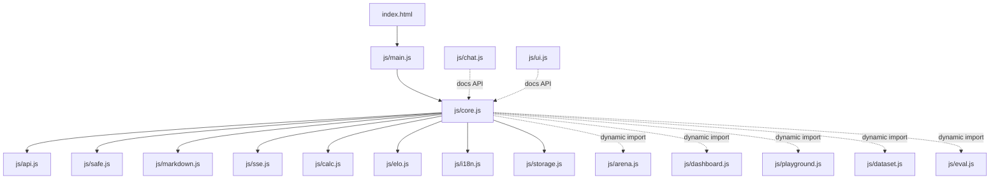

# МойGPT — веб-чат

Статический UI (без сборки и CDN) для собственного чата команды.

**v15:** демо «Итоги», SFT-арена, polish; **v14:** нативный split `js/features/*` (lazy), initial JS &lt; 120 KiB, SVG bpc-кривая в «Эволюции», `?demo=1` презентация, static innerHTML check.

**v13:** нативные ES-модули (`js/`), точка входа `js/main.js`, тяжёлые вкладки подгружаются через `import()`.

## Палитра

| Токен | Hex |
|-------|-----|
| bg | `#0b0f14` |
| surface | `#121820` |
| surface2 | `#1a2330` |
| border | `#2a3544` |
| text | `#e8eef5` |
| muted | `#8b9bb0` |
| accent | `#3dd6c6` |
| spark | `#f0a030` |
| user | `#1a3340` |
| bot | `#161d28` |
| danger | `#e85d5d` |

## Запуск

**Боевой** (Grok Bot, порт 8800, mount `web/`):

```bash
# уже крутится uvicorn api.server — UI на http://127.0.0.1:8800/
```

**Мок** (если API ещё нет):

```bash
python3 web/mock_server.py   # http://127.0.0.1:8090/
```

Конфиг URL — `js/api.js` (`API.base: ""` = same-origin). Legacy-снимок: `app.js` (не подключается).


## Архитектура (v13)

Без бандлера: браузер грузит ES-модули напрямую.



| Модуль | Роль |
|--------|------|
| `main.js` | `boot()` |
| `core.js` | оболочка UI, чат, стримы |
| `api.js` / `storage.js` / `i18n.js` | контракт API, ключи LS, строки |
| `safe.js` / `markdown.js` / `sse.js` / `calc.js` / `elo.js` | чистые хелперы (+ unit-тесты) |
| `arena.js` … `eval.js` | lazy-вкладки |
| `chat.js` / `ui.js` | публичная карта API для дерева чатов / оверлеев |

### Тесты

```bash
node --test web/tests/unit/*.test.mjs   # pure modules
python3 web/tests/smoke.py              # Playwright smoke :8090
python3 web/tests/visual_regression.py  # скриншоты vs web/tests/baseline/
python3 web/tests/perf_metrics.py after # LCP/TBT/JS size
```

## Контракт API (primary)

| Метод | Путь | Назначение |
|-------|------|------------|
| GET | `/api/health` | `{ok, chunks?, model?}` — точка статуса в шапке |
| GET | `/api/models` | `{models:[...]}` или `[...]` |
| POST | `/api/chat` | стрим ответа |
| GET | `/api/stats` | обучение / корпус (см. ниже) |
| POST | `/api/train` | «Дообучить» |

### POST `/api/chat`

Тело:

```json
{
  "messages": [{"role":"user"|"assistant","content":"..."}],
  "model": "mygpt-latest",
  "max_new_tokens": 200,
  "temperature": 0.8,
  "top_k": 50,
  "top_p": 0.95,
  "repetition_penalty": 1.15,
  "use_rag": true,
  "attachments": [{"name":"a.txt","text":"..."}],
  "raw": false,
  "stop": ["\n\n", "User:"],
  "n": 1
}
```
**v12 / Playground (f89f86f):** `raw:true` — complete последнего сообщения as-is (без chat-template); `stop: string[]` ≤8 (stop-строка в ответ не входит); `n` 1..4 — несколько вариантов, в чанках поле `i`, после каждого варианта при `n>1` приходит `event: end` `data: {"i":…}`. Каждый чанк несёт `lp` (ln p) — UI показывает logprob напрямую. Playground шлёт raw/stop/n; при ошибке сервера — fallback на цикл `/api/next`.

Поля `top_p` и `repetition_penalty` — на чат; сервер применяет все 5 gen-полей (defaults: top_p 0.95, repetition_penalty 1.15). В настройках — «Сбросить к серверным».
**Clamp (сервер c6ba48b / UI v10):** `max_new_tokens` 1..4096 · `temperature` 0..5 · `top_k` 0..500 · `top_p` 0.01..1 · `repetition_penalty` 0.5..3. Слайдеры UI совпадают с этими диапазонами.

Стрим (рекомендуемый): `text/event-stream`

```
data: {"content":"кусок"}

event: sources
data: {"sources":[{"title":"...","url":"https://...","score":12.1}]}

data: [DONE]
```

Также принимаем:

- сырой `text/plain` по кускам;
- финальный JSON-чанк с полем `sources` / `answer`;
- чипы **Источники** строятся из `title` + `url` (fallback: `src`, иначе «Источник N»).

### GET `/api/stats`

Ожидаем либо содержимое `model/stats.json`:

```json
{
  "step": 120, "total": 5000, "loss": 1.23, "val_loss": 1.4,
  "ppl": 3.4, "tokens_per_sec": 110, "checkpoint": "v1",
  "loss_history": [{"loss": 2.1}, {"loss": 1.8}]
}
```

либо обёртку текущего сервера:

```json
{"docs":{...},"corpus_bytes":123,"chunks":999,"train":{...}|null,"model":true}
```

Панель «Обучение» поллит раз в 3 с. Если `loss_history` нет — копит loss с поллингов. 404 → «нет данных».

### POST `/api/train`

«Дообучить» → `{started, running, pid?}`. 404 показывается мягко в панели.

## Fallback (если `/api/*` → 404)

| Primary | Fallback |
|---------|----------|
| `/api/chat` | `POST /chat/stream` body `{message, history, ...}` |
| `/api/stats` | `GET /stats` |
| `/api/train` | `POST /train` или `/train/resume` |
| `/api/health` | `GET /health` |

## UI-фичи

- История в `localStorage`, переименование/удаление
- Стрим + курсор, **Стоп** (AbortController)
- Чипы **Источники**, **Заново**, **Изменить** последнее user-сообщение
- Экспорт чата в `.md`
- Панель **Обучение** + canvas loss + **Дообучить**
- Health-dot в шапке
- Mobile ≤760px: сайдбар-drawer

## FastAPI mount

```python
# API-роуты объявлять ДО mount
app.mount("/", StaticFiles(directory="web", html=True), name="web")
```

## Скриншоты

- `screenshot.png` — чат с источниками (1280×800)
- `screenshot-train.png` — панель обучения
- `screenshot-mobile.png` — 390×844


## UI v3

- Режим **Сравнение**: две модели параллельно, у каждой свой Стоп
- Под ответом: model · tok/s · время
- System prompt на чат → `messages[0] role=system`
- Тема light/dark (`localStorage mygpt.theme`)
- Поиск по истории в сайдбаре
- Клавиши: Ctrl+K новый, Esc стоп, / фокус; подсказка «?»
- «Копировать» на code blocks
- Источники: tooltip score≈%; пустые title+url скрываются, иначе label = host URL

Скриншоты: `screenshot.png`, `screenshot-compare.png`, `screenshot-light.png`


## Оценка

`GET /api/eval` → массив из `eval/results.jsonl` (поля: ckpt, step, params_M, val_ppl, bpc, qa_score, qa_total, sec, ts, qa[]). UI дедупит по ckpt (latest ts), сравнивает по **bpc** (ниже лучше), QA как `qa_score/qa_total`, раскрываемые QA с фильтром по cat.


## UI v4

- **Корпус**: `GET /api/search?q=&k=10` (RAG). Ссылки только `http(s)://`, иначе `<span>`.
- **Feedback**: 👍/👎 → `POST /api/feedback`; 404 → localStorage «сохранено локально».
- Голос (Web Speech API, ru-RU), экспорт HTML, PWA (`manifest.json`, `sw.js` — без `/api`).
- `GET /api/eval?latest_only=true`
- Light accent `#087266`, danger `#a12f2f` (контраст ≥ 4.5:1)


## UI v5 — Лаборатория (контракты для API)

### `POST /api/tokenize`
```json
// request
{ "text": "Привет", "model": "mygpt-latest" }
// response
{ "tokens": [ { "id": 123, "text": "При" }, { "id": 456, "text": "вет" } ] }
```

### `POST /api/next`
```json
// request
{ "prompt": "МойGPT:", "model": "mygpt-latest", "top_k": 10, "temperature": 0.8 }
// response
{ "candidates": [ { "id": 123, "text": " мир", "p": 0.22 }, { "id": 456, "text": " —", "p": 0.18 } ] }
```
`p` — вероятность (0..1). `id` — id токена (опционально). Клик по кандидату в UI дописывает `text` к промпту и повторяет запрос.

### SSE `/api/chat` — опциональная уверенность
Каждый текстовый чанк может нести вероятность сэмпла:
```
data: {"content":"токе","p":0.81}
```
Если хотя бы один чанк содержит `p`/`prob`, UI включает «подсветка уверенности».

### `GET /api/stats` — примеры обучения
Опционально:
```json
{ "samples": [ { "step": 100, "text": "МойGPT: ..." } ] }
```
Показывается таймлайном во вкладке «Обучение».

### Уже live
- `GET /api/search?q=&k=10` → `[{title,url,source,snippet,score}]`
- `POST /api/feedback` → `{ok:true}` (локальный backlog синкается при загрузке UI)


## UI v6

- **Ветвление чата**: дерево `nodes` + `leafId` (localStorage `mygpt.chats.v2`, миграция с v1). «Изменить» / «Заново» создают соседние ветки; переключатель ‹ n/m ›.
- **Персоны**: `mygpt.personas.v1` + системный промпт персоны поверх промпта чата.
- **Вложения**: `.txt`/`.md` ≤ 200 КБ → текст в сообщение (кнопка 📎 / drag-and-drop).
- **Научи этому**: `POST /api/corpus/add` `{title,text,source}` → `{ok,id}`; 404/405 → localStorage.
- **Markdown+**: таблицы, `$…$`/`$$…$$`, списки, `#`/`##`/`###`, цитаты (escape-first).
- **Perf**: debounce save 250 мс; DOM лимит 300 сообщений.
- Скриншоты: `screenshot-lab.png`, `screenshot-branch.png`


## UI v7 — Панель и «О проекте»

### Панель (`?dash=1`)
Данные из `GET /api/stats` (поле `corpus` как в `data/clean/stats.json`: `kept`, `chars`, `kept:<source>`).
Донат по источникам, рост корпуса (история в `localStorage mygpt.corpus.growth.v1`), чекпоинты из `/api/eval?latest_only=true` + текущий `step/params_M`, health, последняя строка обучения (`losses` / `train_log_line`).

### `GET /api/corpus/stats` (желательно)
Если `stats.corpus` не приходит — UI запрашивает:
```json
{
  "kept": 19764,
  "chars": 150164127,
  "kept:fineweb2_ru.jsonl": 12839,
  "kept:wiki_ru.jsonl": 1427,
  "kept:pc_wikisource.txt": 2441,
  "kept:rss_ru.jsonl": 444,
  "kept:wiki_fresh.jsonl": 50
}
```
Сейчас на live может быть 404 — тогда достаточно `corpus` внутри `/api/stats`.

### `POST /api/corpus/add`
```json
// request
{ "title": "…", "text": "…", "url": "https://…" }
// response 200
{ "ok": true, "id": "f6cb…", "note": "попадёт в поиск после ближайшей пересборки…" }
// 413 — слишком большой текст (макс. 256 КБ)
```
UI: мин. 20 символов, клиентский лимит 256 КБ; локальный backlog `mygpt.corpus.local.v1` синкается один раз при загрузке.

### Вложения в чат
`POST /api/chat` принимает `attachments:[{name,text}]` (сервер обрезает каждый текст до 4000 символов). UI предупреждает, если файл длиннее.

### «О проекте»
`about.html` — SVG-конвейер, роли ботов, лицензии данных.

### Smoke
```bash
python3 web/tests/smoke.py   # mock :8090
```
Скриншоты: `screenshot-dashboard.png`, `screenshot-about.png`.


## UI v8

### Библиотека промптов
`localStorage mygpt.prompts.v1` — `{id,name,slash,body}[]`. Slash-меню по `/` в поле ввода. Импорт/экспорт JSON.

### Поиск по сообщениям
Ctrl+F / кнопка ⌕ — поиск по всем чатам, подсветка сниппета, прыжок в чат.

### Настройки генерации (на чат)
В панели «Настройки»: `temperature`, `top_k`, `top_p`, `max_tokens` (=`max_new_tokens`), `repetition_penalty`.
Хранятся в `chat.genSettings`, уходят в `POST /api/chat`.

### Тепловая карта токенов
Тоггл в настройках; красит чанки SSE с полем `p` (легенда низкая→высокая).

### Палитра команд
Ctrl+K — все вкладки/действия. Ctrl+N — новый чат.

### Папки и пины
Папки: `mygpt.folders.v1` + `chat.folderId`. Пин `chat.pinned`. Drag-and-drop перестановка / в папку.

### Панель — `GET /api/corpus/stats` (live)
```json
{
  "sources": {"fineweb2_ru.jsonl": {"docs": 13130, "bytes": 150046462}, "pc_wiki.txt": {"docs": null, "bytes": 2935553}},
  "raw_bytes": 299921854,
  "clean": {"corpus.jsonl": {"bytes": 273956044, "mtime": 1794205943, "docs": 19764}},
  "user_add": 3,
  "rag_chunks": 152917,
  "ts": 1794206682,
  "build": {"<EMAIL>": 548, "<PHONE>": 359, "dup_near": 125, "dup_exact": 11, "built_at": "09:32", "kept": 19764}
}
```
Донат предпочитает `build['kept:<файл>']` (число документов), иначе `sources.*.bytes`. Карточка «Очистка» — scrub/dup/`built_at` из `build`. Числа в innerHTML через `Number()`/`fmtNum`, ключи — `escapeHtml`.

Скриншоты: `screenshot-v8-palette.png`, `screenshot-v8-settings.png`, `screenshot-v8-heatmap.png`.

## UI v9

### Арена
Режим «Арена»: один промпт → две модели (`/api/models`) бок о бок. Голос A/B/ничья → `POST /api/feedback` с `{type:'arena', vote, model_a, model_b, prompt, answer_a, answer_b}`. Локальный Elo (K=32) во вкладке «Elo».

### Объяснить
Кнопка под ответом: пошаговый replay через `POST /api/next` (top-кандидаты на каждом шаге, авто/ручной выбор).

### Онбординг
Первый визит — 5 шагов (пропуск / Ctrl+K «Обзор»). `localStorage mygpt.tour.done.v1`.

### Mobile
Bottom-sheet для настроек, swipe от края → сайдбар, `safe-area-inset-*`, скрин 390×844.

### A11y
Focus trap в модалках, `aria-live` на сообщениях/арене, `prefers-reduced-motion`.

### Workspace
Экспорт/импорт JSON schema v1: chats, folders, prompts, personas, theme, elo, heatmap.

Скриншоты: `screenshot-v9-arena.png`, `screenshot-v9-explain.png`, `screenshot-v9-mobile.png`.


## UI v10

### Датасет
Вкладка «Датасет»: `GET /api/search?q=&k=20`, чипы фильтра по `source`, превью документа, локальный сборщик SFT.
Экспорт JSONL (`mygpt.sft.v1`), одна строка:

```json
{"messages":[{"role":"user","content":"…"},{"role":"assistant","content":"…"}],"meta":{"title":"…","url":"https://…","source":"wiki_ru.jsonl","score":12.1,"added_at":"ISO"}}
```

@Grok Bot: формат для `scripts/build_sft.py` / будущего `v1_sft`.

### Обучение live
Поллинг `/api/stats` каждые **5 с**. График loss с smoothing-слайдером, ETA, tok/s, таймлайн samples. Notification API (opt-in) при смене checkpoint.

### Eval diff
Два чекпоинта из `/api/eval` → QA бок о бок с бейджами OK/FAIL и ≠/=.

### Шаринг
Standalone HTML и PNG-карточка (canvas) текущего чата.

### i18n
Тоггл RU/EN (`mygpt.lang.v1`) для ключевых строк UI.

### Perf
Виртуализация сообщений (`MAX_RENDER_MSGS=120`), lazy open вкладок, кнопка ⚡ / команда «Perf check» (DOM nodes, DCL, heap).

### Модели / Арена
`GET /api/models` → `mygpt-latest`, `v0`, `v1`, `step_*`, `rag-only` (+ `*_sft` позже).
`POST /api/chat` принимает `model` (чекпоинт). Дропдауны с optgroup: **Релизы** / **Шаги** / **RAG**.
Арена: по умолчанию разные модели (latest vs v0); одинаковые — авто-правка + хинт. Elo ключ = model id.

### Gen clamp
Слайдеры = серверные диапазоны (см. выше).

Скриншоты: `screenshot-v10-dataset.png`, `screenshot-v10-train.png`, `screenshot-v10-evaldiff.png`.


## UI v11

### Похожие чаты
TF-IDF в Web Worker (`tfidf-worker.js`) по локальным чатам — без эмбеддингов. Сайдбар «Похожие чаты».

### Карточка модели
Вкладка «Модель»: params/step/bpc/val_ppl/QA из `GET /api/eval`, разбивка QA по `cat`, сводка корпуса из `GET /api/corpus/stats`, samples из `/api/stats`. **bpc** — primary (ниже лучше); `val_ppl` с tooltip «не сравнима между разными токенизаторами».

### Token budget
Debounced `POST /api/tokenize` при вводе → полоса context window (2048), warn ≥70%, danger ≥90%.

### Playground
Raw completion без chat-template: итеративный `POST /api/next`, stop-sequences, n-best, logprob на токене.

### Уведомления
Центр 🔔: polling stats/eval/corpus каждые 15 с (checkpoint / eval / corpus rebuild), unread badge.

### Theme builder
Accent color picker + WCAG AA contrast vs bg. Сохраняется в `mygpt.accent.v1` и workspace JSON.

### Offline
SW `mygpt-static-v11` кэширует shell (+ `tfidf-worker.js`, `about.html`). Очередь сообщений `mygpt.offline.queue.v1` → flush при online.

### Eval diff (уточнение)
Live: v0 bpc≈2.69 / v1 bpc≈2.20 (лучший). Per-category QA pills. ppl tooltip.

Скриншоты: `screenshot-v11-modelcard.png`, `screenshot-v11-playground.png`, `screenshot-v11-theme.png`.


## UI v12

- **Эволюция** — один промпт по `step_00500…latest` (из `/api/models`), горизонтальный скроллер, bpc из `/api/eval`
- **Инструменты в чате:** `/calc` (безопасный парсер, без `eval`), `/wiki <q>` (`/api/search` + цитата), `/time` (Europe/Moscow) — карточки tool
- **Редактирование** сообщения с перегенерацией и diff старый/новый ответ
- **Code blocks:** локальный syntax highlight, номера строк, копирование, Run JS в `iframe sandbox="allow-scripts"` (без same-origin) + панель вывода
- **Статистика чатов:** messages/day, ср. токены, pie моделей, feedback ratio
- **Print stylesheet** + лист горячих клавиш `?`
- **Playground** → `/api/chat` с `raw`/`stop`/`n`/`lp`, варианты вкладками; fallback `/api/next`

Скриншоты: `screenshot-v12-evolution.png`, `screenshot-v12-tools.png`, `screenshot-v12-code.png`

## UI v13

- ES-модули без сборки и CDN; `<script type="module" src="js/main.js">`
- Lazy `import()` для arena / dashboard / playground / dataset / eval
- Unit-тесты: markdown (в т.ч. `javascript:`), calc, SSE (`n`/`i`/`end`), Elo, URL XSS
- Visual regression (Playwright + pixel threshold) и perf-метрики
- Hotfix XSS `/wiki` (см. `307a6c9`) перенесён в модули (`safe.js` + DOM `makeExternalLink`)


## UI v14

- Реальный split: `js/core.js` (чат) + `js/features/*.js` через `import()` / `ensureFeat`
- Initial JS (main+core+safe+markdown) &lt; 120 KiB; sse/i18n/calc/elo/вкладки — lazy
- «Эволюция»: SVG-кривая bpc по `step_*` из `/api/eval`, auto-refresh
- Режим презентации: `/?demo=1` (Space пауза, ←/→ шаги, Esc выход)
- `tests/static_innerhtml_check.mjs` — attr-concat XSS; `buggyWikiHrefAttr` только в `tests/helpers/`


## UI v15

- Demo `?demo=1`: арена auto-pair `*_sft` vs база (иначе `latest` vs `v0`); финальный слайд **Итоги** (headline = best bpc, QA вторично / подсветка только SFT vs base)
- SFT readiness: toast «Новая модель» + «Сравнить в арене» при появлении `*_sft` в `/api/models`
- Polish: spacing tokens, skeletons / empty / loading / error, light-theme contrast
- `web/demo/demo.webm` + poster; live e2e против `:8800`
